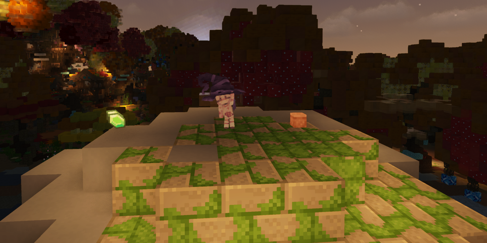
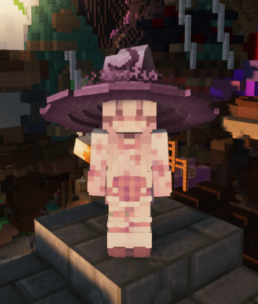
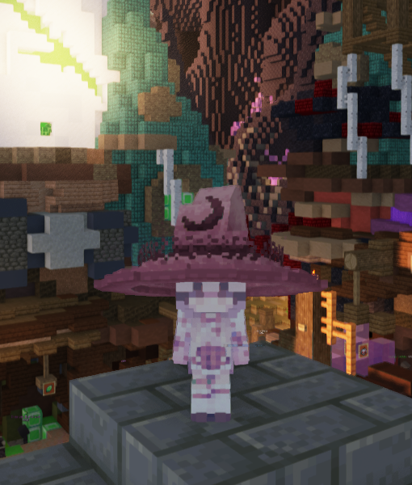

# MiniWynn

Small bodies. Bigger heads. A little more character in Wynncraft.



MiniWynn makes players and villagers smaller on your screen, with bigger heads and the same skins
and gear. It's a client-side Fabric mod for Minecraft 1.21.11, made with Wynncraft
in mind.

**[Download MiniWynn](https://github.com/KiraDiamond/MiniWynn/releases/latest)** ·
[Report an issue](https://github.com/KiraDiamond/MiniWynn/issues) ·
[What's changed](CHANGELOG.md)

## See the difference

| Without MiniWynn | With MiniWynn |
| :---: | :---: |
|  |  |

Same character, same location, slightly different camera positions. Both images
use equal-sized crops with no resizing or retouching.

## What it does

- Renders player bodies at **55% size**, with heads **1.5 times larger relative to the body**.
- Scales skins, armour, and held items with the character.
- Lowers labels attached to small NPCs while keeping the text readable.
- Supports Wynncraft's emote models, hats, and character previews.
- Works automatically, with no settings or keybinds.

Hitboxes, reach, movement, and camera height stay the same. The effect is only
visible on the client with MiniWynn installed.

## Install

| Requirement | Version |
| --- | --- |
| Minecraft Java Edition | 1.21.11 |
| Fabric Loader | 0.18.4 or newer |
| Java | 21 |

1. Download **miniwynn-1.0.5.jar** from [Releases](https://github.com/KiraDiamond/MiniWynn/releases/latest).
2. Put it in your Fabric instance's `mods` folder.
3. Restart Minecraft.

Fabric API isn't needed. Remove older Small People or SmallMod JARs before
installing MiniWynn. Use the regular JAR to play; the source ZIP is for building
or editing the mod.

## A few things to know

The screenshots show the standard player model in-game. Emotes, animated hats,
mounts, crouching, and the class preview still need more in-game checks.

Player-shaped NPCs can also look small. Wynncraft's custom models can change, so
some emotes or cosmetics may need adjustments after a server update. If something
looks off, [open an issue](https://github.com/KiraDiamond/MiniWynn/issues) with a
screenshot and your mod list.

## Build it yourself

Use JDK 21 and the included Gradle wrapper.

Windows:

```powershell
.\gradlew.bat build
```

Linux / macOS:

```sh
./gradlew build
```

The finished mod is `build/libs/miniwynn-1.0.5.jar`. The build also runs the
regression checks. To run them separately, use `./gradlew regressionTest`
or `.\gradlew.bat regressionTest`.

## License

MiniWynn's code is [MIT licensed](LICENSE). See [THIRD_PARTY.md](THIRD_PARTY.md)
for tool and dependency notices, and [PROVENANCE.md](PROVENANCE.md) for how this
implementation was developed and checked.

Screenshots were supplied by KiraDiamond. Crops preserve the original game pixels.
Wynncraft's world, textures, and cosmetics belong to their respective creators.
